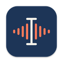

<p align="center"></p>

<h1 align="center">Dictate</h1>

<p align="center">
  <b>Talk instead of typing, on macOS, Windows and Linux.</b><br>
  Your words are written into the text field you are in, with the speech recognized on your own computer.<br>
  Dictate also records and summarizes meetings, and lets your AI assistant read them.
</p>

<p align="center">
  <a href="https://github.com/henryonai/dictate/releases/latest"><b>Download</b></a> ·
  <a href="#download-and-install">Install</a> ·
  <a href="#using-dictate">Usage</a> ·
  <a href="#privacy">Privacy</a> ·
  <a href="README.vi.md">Tiếng Việt</a>
</p>

<p align="center">
  
  
  
  <a href="LICENSE"></a>
  <a href="https://github.com/henryonai/dictate/releases/latest"></a>
</p>

## Features

**Dictate into any text field.** Click into a chat box, an email or a document and press the shortcut (`Ctrl+Alt+Space`, `⌃⌥Space` on a Mac; you can change it). Your words show up next to the cursor while you talk. When you stop, Dictate writes the text into the field, and, when you have set up an AI, fixes mistakes and punctuation first.

**Rewrite what you just said.** A small chip next to the text has a **⋯** menu for another version: shorter, an email, bullet points, a translation…

**Record and summarize meetings.** Record your screen, one window or just the audio, or add an audio or video file, or a link (YouTube and the other sites that yt-dlp supports). Dictate writes the transcript, tells the speakers apart (Speaker 1, 2…) and, when an AI is set up, writes a summary with the decisions and the action items. Timestamps jump to that moment of the recording, and you can ask questions about it.

**Ask your AI assistant about your meetings.** A built-in [MCP server](#ask-claude-about-your-meetings-mcp) (`dictate-mcp`) lets Claude Code, Claude Desktop or any MCP client read your recordings.

Speech is recognized on your computer with [Whisper](https://github.com/ggml-org/whisper.cpp): nothing of your voice leaves it unless you choose a transcription API. The interface is available in English and Vietnamese (Settings → General → *Interface language*; by default it follows the system).

## Download and install

Download the installer for your system from [Releases](https://github.com/henryonai/dictate/releases/latest). `<version>` in the names is the release number, such as `2.0.0`.

| System | Installer | Checksum file | Needs |
|---|---|---|---|
| macOS, Apple silicon (M1 and later) | `Dictate_<version>_aarch64.dmg` | `Dictate_<version>_aarch64.dmg.sha256` | macOS 13 or later |
| macOS, Intel | `Dictate_<version>_x64.dmg` | `Dictate_<version>_x64.dmg.sha256` | macOS 13 or later |
| Windows, 64-bit | `Dictate_<version>_x64-setup.exe` | `Dictate_<version>_x64-setup.exe.sha256` | Windows 10 or 11 |
| Linux, 64-bit | `Dictate_<version>_amd64.deb` | `Dictate_<version>_amd64.deb.sha256` | glibc 2.39 or later (Ubuntu 24.04 or later) |

The installers are not signed: read [Unsigned builds](#unsigned-builds) before you open the first one.

### macOS

1. Open the `.dmg` and drag **Dictate** to **Applications**. Install it there before you first open it: *Open Dictate at login* remembers where the app is.
2. Open it. macOS blocks the first launch of an unsigned app; [Unsigned builds](#unsigned-builds) shows how to allow it.
3. Dictate lives in the menu bar (there is no Dock icon). Continue with [First run](#first-run).

### Windows

1. Run the `.exe`. It installs for your user only, with no administrator rights, and offers to start Dictate when it is done. The Visual C++ runtime that the app needs comes with it. Windows 11 has the WebView2 runtime that the windows of the app use; on Windows 10 the installer downloads it when it is missing, so it needs a network connection.
2. Windows SmartScreen warns about the unsigned installer: [Unsigned builds](#unsigned-builds) shows how to go on.
3. Dictate lives in the notification area of the taskbar (click **^** if you don't see the icon). Continue with [First run](#first-run).

### Linux

The `.deb` is for Ubuntu 24.04 or later. It is built on Ubuntu 24.04, so it needs glibc 2.39 or later; other Debian-family systems with such a glibc (Debian 13, for one) should work too, but are not tested. Install it with `apt`, which also fetches the libraries that Dictate needs (replace `<version>` with the version of the file you downloaded, such as `2.0.0`):

```sh
sudo apt install ./Dictate_<version>_amd64.deb
```

The package puts `dictate` and `dictate-mcp` in `/usr/bin` and its own libraries in `/usr/lib/dictate`. It recommends `gstreamer1.0-libav` and `gstreamer1.0-plugins-good` (to play recordings), `xdg-desktop-portal` (to record the screen) and `pulseaudio-utils` (to record the sound of the computer), and `apt` installs those with it unless you tell it not to. Start Dictate from the application menu or with `dictate`. The tray icon needs a desktop that shows app indicators (GNOME needs the AppIndicator extension). [Dictation on each system](#dictation-on-each-system) says what Wayland needs.

### Unsigned builds

Dictate has no signing certificate yet, so the macOS and Windows installers are neither signed nor notarized. The systems warn you the first time, which is expected. [Verify the download](#verify-the-download) to be sure that the file is the one on the release page.

- **macOS 15 and later:** open Dictate once; macOS says it can't check the app. Open **System Settings → Privacy & Security**, scroll down to the message about Dictate, click **Open Anyway** and confirm. (On macOS 13 and 14 you can also Control-click the app and choose **Open**.) If macOS says the app "is damaged and can't be opened", remove the flag that marks it as downloaded, and open it again:

  ```sh
  xattr -dr com.apple.quarantine /Applications/Dictate.app
  ```

- **Windows:** SmartScreen shows "Windows protected your PC". Click **More info**, then **Run anyway**. On Windows 11 with **Smart App Control** turned on (a new install of Windows 11 may have it on; Settings → Privacy & security → Windows Security → App & browser control → Smart App Control settings shows it) there is no such button: it blocks an unsigned installer outright. Turning it off lets the installer run, but Microsoft does not let you turn it back on without resetting or reinstalling Windows, so think before you do it on a computer you care about.
- **Linux:** nothing to allow.

### Verify the download

Each installer has a checksum file next to it on the release page, with a line of the form `<hash>  <file name>`. Download both into the same folder and check. In each command, replace `<version>` with the version of the files you downloaded (such as `2.0.0`):

```sh
shasum -a 256 -c Dictate_<version>_aarch64.dmg.sha256
```

on macOS (use the name of the `.dmg` you downloaded: `_aarch64` for Apple silicon, `_x64` for Intel),

```sh
sha256sum -c Dictate_<version>_amd64.deb.sha256
```

on Linux, and on Windows, in PowerShell (with the version of your `.exe` in both file names), which prints `True` when the file is the right one:

```powershell
(Get-FileHash -Algorithm SHA256 .\Dictate_<version>_x64-setup.exe).Hash -eq (Get-Content .\Dictate_<version>_x64-setup.exe.sha256).Split(' ')[0]
```

A checksum from the same page shows that the download is whole, not who made it. The installers are built by [GitHub Actions](https://github.com/henryonai/dictate/actions) from the source of the release.

### Updating

There are no automatic updates yet: download the new installer and install it over the old one (on a Mac, quit Dictate and drag the new app over the old one; on Linux, `sudo apt install` the new `.deb`). Your settings, models and library stay where they are. The builds are unsigned, so after an update macOS may take the app for a different one and ask for the permissions again: see [First run](#first-run).

### Uninstalling

Quit Dictate first (the tray or menu bar icon, **Quit**). Your recordings, in the `Dictate Meetings` folder of your Documents, are never removed.

- **macOS:** drag `Dictate.app` from Applications to the Trash. The settings, the models and the saved dictations stay in `~/Library/Application Support/Dictate`, and the API keys in Keychain Access (the items whose service is `Dictate`).
- **Windows:** Settings → Apps → Installed apps → Dictate → Uninstall. The uninstaller removes the program (its files and shortcuts) and none of your data, **and the box "Delete the application data" does not change that:** it removes only the folders that are named after the identifier of the app (`io.github.henryonai.dictate`). The downloaded speech models and the saved dictations stay in `%LOCALAPPDATA%\Dictate`, the settings in `%APPDATA%\Dictate`, and the API keys in Credential Manager (`default.Dictate` and `transcribe.Dictate`). To remove them too, after the uninstall, in PowerShell:

  ```powershell
  Remove-Item -Recurse -Force "$env:LOCALAPPDATA\Dictate", "$env:APPDATA\Dictate"
  cmdkey /delete:default.Dictate
  cmdkey /delete:transcribe.Dictate
  ```

- **Linux:** `sudo apt remove dictate` removes the program. The settings (`~/.config/Dictate`), the models and the saved dictations (`~/.local/share/Dictate`) stay, and so do the API keys in the Secret Service (the Passwords and Keys app). To remove the files too:

  ```sh
  rm -rf ~/.config/Dictate ~/.local/share/Dictate
  ```

### Replacing the Swift Dictate on macOS

This app replaces the older Swift Dictate (versions 1.x). It has the same name and goes in the same place, so you install it like any update:

1. **Quit the old one first** (menu bar icon → Quit).
2. Drag the new `Dictate.app` into `/Applications` and choose **Replace**.
3. Grant the permissions again: macOS sees a different app, so Microphone, Accessibility and Screen Recording have to be turned on again ([First run](#first-run)). Settings and API keys are not carried over either: enter them again in Settings.

The old app's own files stay where they were and the new one does not use them: the WhisperKit models in `~/Library/Application Support/Dictate/Models` and the recordings of its dictation in `Recordings` next to them. You can delete both folders to free the space.

What stays: your library (the `Dictate Meetings` folder in Documents has the same format, and the recordings of the old app open as they are) and the path of the MCP server, `/Applications/Dictate.app/Contents/MacOS/dictate-mcp`, so Claude Code and Claude Desktop keep working with no change. What is gone: Apple Speech and WhisperKit. Speech is recognized with Whisper models that you download again in Settings.

## First run

1. **Permissions (macOS).** Settings → General → *Permissions* shows each one, with a button that asks for it or opens the right pane of System Settings:

   | Permission | Used for | When |
   |---|---|---|
   | Microphone | Dictation and the microphone of a recording | Asked the first time you dictate |
   | Accessibility | Finding the text field you are in and pasting the text there. Without it, the text comes out in a card to edit and copy | Settings → General → Permissions → *Grant access…* |
   | Screen Recording | Recording the screen and the sound of the computer, even with *Audio only* | Asked at the first screen recording; reopen Dictate after you turn it on |

   Windows and Linux ask for nothing at install time: see [Dictation on each system](#dictation-on-each-system) for what each one needs.

2. **Choose a Whisper model.** Settings → *Speech recognition* → *Whisper models*: click **Download** next to the one marked *Recommended* (it depends on the memory of the computer; **Tiny** and **Base** are weak for Vietnamese, **Small** and larger are better). The model is downloaded once, from Hugging Face, and speech is then recognized offline. Until a model is there, dictation says so.
3. **Optional: set up an AI**, for the editing of dictation and for summaries. Settings → *Accounts & API keys* → *AI*, then click **Check**:
   - **Anthropic:** base URL `https://api.anthropic.com`, a model such as `claude-haiku-5-5` (fast) or `claude-sonnet-5-5`, and your API key.
   - **OpenAI-compatible:** OpenRouter (`https://openrouter.ai/api/v1`), OpenAI, or a local server such as Ollama (`http://localhost:11434/v1`), with a model that the endpoint has.

   API keys go to the credential store of your system (Keychain, Credential Manager, Secret Service), never to a file. Without an AI, dictation still works, the text is just not edited, and a recording gets a transcript and no summary.
4. **Choose the language of your dictation:** Settings → *General* → *Dictation* → *Language* (it starts as English (US); choose *Tiếng Việt* to speak Vietnamese).
5. **Click into any text field, press the shortcut, talk, and press it again.**

## Using Dictate

### Dictation

| Action | Key |
|---|---|
| Start / stop dictating | `Ctrl+Alt+Space` (`⌃⌥Space` on a Mac); change it in Settings → General, which also has a hold-to-talk mode |
| Write it as it is, skipping the AI edit | press the shortcut again while the bubble says "Editing: …" |
| Another version of what was just written | click **⋯** on the chip next to it |
| Cancel while talking | `Esc` |
| On the card (when no text field has the focus): edit styles | `Ctrl+1–5` (`⌘1–5` on a Mac) |

**Writing into text fields** (Settings → General → *Write into the focused text field*, on by default): while you talk, a bubble with the live text sits next to the cursor. When you finish, Dictate fixes mistakes and punctuation with your AI (the default style is in the *AI editing & summaries* tab) and pastes the result into the field. After that, a small chip stays by the text for a few seconds: its **⋯** menu rewrites the text in place (shorter, an email, bullet points, formal, an AI prompt, a translation into English or Vietnamese, the original, a request of your own). Typing, clicking elsewhere or switching apps makes the chip go away, and Dictate leaves the field alone from then on.

With no text field focused, or with that setting off, a card opens to edit and copy the text. Add names and terms to *Custom vocabulary / context* (Settings → *AI editing & summaries*) so that the AI spells them right.

**Saved dictations.** With *Save recordings + transcripts* on (the default), the audio and the text of each dictation are kept in `Dictate/Dictations` in your local data folder (the tray menu opens it). A dictation that is not saved leaves nothing behind.

#### Dictation on each system

- **macOS:** dictation needs the Microphone and Accessibility permissions (see [First run](#first-run)). The app is not signed, so after a rebuild or an update Accessibility may need granting again: remove Dictate from the list in System Settings → Privacy & Security → Accessibility and add it again.
- **Windows:** an app that runs as administrator can't be pasted into by a normal app: Dictate copies the text and the card says so, and you press `Ctrl+V`. If the microphone only records silence, check Settings → Privacy & security → Microphone and let desktop apps use it.
- **Linux:** X11 works. On Wayland no app can press keys in another one, so install `wtype` (wlroots desktops such as Sway, and Hyprland) or `ydotool` so that Dictate can paste; without either, the text is copied and you press `Ctrl+V`. The shortcut comes from the desktop's GlobalShortcuts portal (KDE Plasma, GNOME 48 and later, Hyprland); where there is none (Sway and other wlroots desktops), bind a key in the desktop's settings to run `dictate --toggle`.

`dictate --toggle` does what pressing the shortcut once does, also when the app is not running yet, and `dictate --record` does the same for a recording. The program is not on the path of every system:

| System | Program to run |
|---|---|
| macOS | `/Applications/Dictate.app/Contents/MacOS/dictate` |
| Windows | `%LOCALAPPDATA%\Dictate\dictate.exe` |
| Linux | `dictate` |

### Meetings, videos and links

The tray menu's **Meetings…** opens the library: add a recording and Dictate makes a transcript, tells the speakers apart (Speaker 1, 2…) and, when an AI is set up, writes a summary with key points, decisions, action items to tick and chapters that jump to that moment of the recording. Ask a question about a recording, rename the speakers, export the Markdown, or move a recording to the Trash (Recycle Bin).

- **Importing.** Choose audio or video files, drag them onto the window, or paste a link (YouTube or any site that yt-dlp supports) with `Ctrl+V` / `⌘V` anywhere in the window. **The files you add are not copied or moved:** the recording keeps pointing at the original, so keep it where it is. If it is moved or deleted, the transcript and the summary stay, and playback says the file is gone.
- **The library folder** is `Dictate Meetings` in your Documents folder, with one folder per recording, named by its start time, and `transcript.txt`, `summary.md`, `tasks.json`, `log.txt` and `meta.json` in it. The library of the old Swift app has the same format. Set `DICTATE_MEETINGS_DIR` (a leading `~` means your home folder) before you start the app to use another folder, for example to try it out without touching your real library; `dictate-mcp` reads the same variable.
- **Speech to text.** Local Whisper by default; the **Transcription API** (OpenRouter, OpenAI, Groq or your own endpoint) is an option for files and for dictation (Settings → *Speech recognition* and *Accounts & API keys*). The first time speakers are separated, Dictate downloads two models (about 46 MB).
- **Playback on Linux** needs the GStreamer libav plugin, which the `.deb` recommends: `sudo apt install gstreamer1.0-libav gstreamer1.0-plugins-good`. Without it the window says what to install; the transcript and the summary work all the same.

### Recording

The tray menu's **Record & summarize…** (and the **Record** button of the Meetings window) opens a picker. Choose what to record and press **Start recording**; when you stop, the recording goes through the same steps as an imported file: transcript, speakers and, when an AI is set up, a summary.

- **What each mode records.** *Full screen* is a display, with the sound of the computer and your microphone (with several displays the picker lets you choose; the main one is the default). *Single window* is one window, until you stop or close it. *Audio only* is sound without a picture. In every mode the sound of the computer and the microphone can each be turned off (not both in *Audio only*). *Video quality* is **Small** (10 frames a second, up to 1280 px on the long side), **Standard** (15, up to 1920; the default) or **Sharp** (30, up to 3840). The picker keeps the mode, the quality and the two sounds for next time.
- **The bar.** While a recording goes on, a small bar at the top of the screen shows the time and a meter for each sound, with **Pause** and **Resume**, **Stop & summarize** and **Discard**. Drag it by its capsule to move it; it never takes the focus.
- **The shortcut.** `Ctrl+Alt+R` (`⌃⌥R` on a Mac) starts and stops a recording from anywhere, with the choices of the last time. When the last mode was *Single window*, it opens the picker instead, because the window is not remembered. On a Wayland desktop with no GlobalShortcuts portal, bind a key in the desktop's settings to run `dictate --record`.
- **When something goes wrong.** If you unplug the headphones or the microphone, the recording goes on with the device that the system has now (what came between is silence) and the bar says "reconnected". If the window you record is closed, the display goes away or the permission is turned off, the recording ends by itself, what was recorded is kept and processed, and a notification says why. If Dictate is ended in the middle of a recording by a crash, the next start finishes it from what is on the disk and loses at most about the last second (two seconds of the picture), and the log says that it was interrupted. A power cut can lose more, because the files are not forced to the disk with `fsync`, so what the system had not written yet is gone. **Quit** in the tray menu while recording saves the recording first (it waits for up to a minute) and then quits.
- **Where it goes.** A recording is a folder of the library like the others, with the video (`recording.mp4`, or `recording.webm` on Linux, where VP9 is the first choice), `audio.m4a` and the rest. Unlike an imported file, it lives in the library.
- **macOS** 13 or later. Recording the screen **and the sound of the computer, even in *Audio only*,** needs the Screen Recording permission (Settings → General → Permissions shows it; reopen Dictate after turning it on). macOS 15 and later ask again from time to time whether Dictate may keep recording the screen: allow it. The recording leaves out all of Dictate's own windows, the bar included. In *Single window* mode the sound of the computer is only what the app of that window plays: choose *Full screen* to record every sound.
- **Windows:** the bar, the Meetings window and Settings are kept out of the video on Windows 10 version 2004 or later; the windows of dictation (the bubble and the card) are not.
- **Linux:** the screen comes from the desktop's ScreenCast portal, so you need `xdg-desktop-portal` and the backend of your desktop (GNOME, KDE Plasma, Hyprland, or `xdg-desktop-portal-wlr` for Sway and other wlroots desktops), on Wayland and X11 alike, and PipeWire (`libpipewire-0.3-0`; a desktop that has PipeWire has it). The desktop's own dialog asks what to share. The sound of the computer is recorded with `parec`, from `pulseaudio-utils`. Linux has no way to leave Dictate's own windows out of the video, so they can appear in it, the bar too.

### yt-dlp and ffmpeg

**ffmpeg is included.** Dictate comes with a build of [FFmpeg](https://ffmpeg.org) under the LGPL, called `dictate-ffmpeg` and kept next to the program. It reads the formats that Dictate can't open by itself, encodes the video of a recording and helps yt-dlp. You install nothing for it. Settings → *Speech recognition* → *Tools for links* shows what Dictate found.

**yt-dlp is not included.** A link needs [yt-dlp](https://github.com/yt-dlp/yt-dlp), which you install yourself: Dictate finds it on the path and in the usual folders of your package manager.

| System | Install yt-dlp |
|---|---|
| macOS | `brew install yt-dlp` |
| Windows | `winget install yt-dlp.yt-dlp` |
| Linux | `pipx install yt-dlp` |

**Using your own ffmpeg.** The LGPL lets you replace the ffmpeg that comes with Dictate. Dictate looks for ffmpeg in this order: the program named by the `DICTATE_FFMPEG` environment variable (a path, or a name on the path), then `dictate-ffmpeg` next to the program, then `ffmpeg` on the path. A value that is empty, or that names a program that cannot run, is ignored. A program that is started from the desktop does not see everything that your terminal sees, so set the variable where the app will read it:

- **macOS:** an app that you open from Finder or the Dock does not see the variables of your shell. Set it for the session with `launchctl setenv`, then quit Dictate and open it again (the setting lasts until you restart the Mac), or start Dictate from a terminal with the variable set:

  ```sh
  launchctl setenv DICTATE_FFMPEG /path/to/ffmpeg
  ```

- **Windows:** make it an environment variable of your user (search the Start menu for "Edit environment variables for your account", or use `setx` in a terminal), then quit Dictate and open it again:

  ```powershell
  setx DICTATE_FFMPEG "C:\path\to\ffmpeg.exe"
  ```

- **Linux:** put it in the environment of the desktop session (for example a file in `~/.config/environment.d/` on a systemd desktop, and log in again), or start Dictate from a terminal with it set:

  ```sh
  DICTATE_FFMPEG=/path/to/ffmpeg dictate
  ```

### Ask Claude about your meetings (MCP)

Dictate comes with `dictate-mcp`, a read-only MCP server. With it, Claude Code and Claude Desktop read the recordings of your library: ask "what did we decide in yesterday's meeting?" or "what's still on my plate?". Claude finds the recordings, reads their summaries and quotes the transcript with `[mm:ss]` timestamps.

| Tool | What it does |
|---|---|
| `list_meetings` | Recordings, newest first: date, length, open action items, the start of the summary. Filter by date or keyword |
| `get_meeting` | The full summary of one recording, with which action items were ticked off in Dictate |
| `get_transcript` | The transcript, or a time range of it (`start`/`end`); long ones come back in parts |
| `search_meetings` | Searches titles, summaries and transcripts, ignoring case and Vietnamese diacritics: "hop" finds "họp" |
| `list_action_items` | Action items across all recordings, filtered by owner, status (open / done) and date |

Where the server is, by system:

| System | Path |
|---|---|
| macOS | `/Applications/Dictate.app/Contents/MacOS/dictate-mcp` |
| Windows | `%LOCALAPPDATA%\Dictate\dictate-mcp.exe` (the folder that the installer used for your user; if you chose another one, use that) |
| Linux (`.deb`) | `/usr/bin/dictate-mcp` |

Run it in a terminal and it prints the command for the place where it is. **Claude Code:**

```sh
claude mcp add --scope user dictate -- /Applications/Dictate.app/Contents/MacOS/dictate-mcp
```

On Windows, in PowerShell:

```powershell
claude mcp add --scope user dictate -- "$env:LOCALAPPDATA\Dictate\dictate-mcp.exe"
```

On Linux, where it is on the path:

```sh
claude mcp add --scope user dictate -- dictate-mcp
```

**Claude Desktop:** Settings → Developer → Edit Config, add `dictate` to `mcpServers` in `claude_desktop_config.json`, then restart Claude:

```json
{
  "mcpServers": {
    "dictate": { "command": "/Applications/Dictate.app/Contents/MacOS/dictate-mcp" }
  }
}
```

On Windows the command is the path above, with every backslash written twice in JSON:

```json
{
  "mcpServers": {
    "dictate": { "command": "C:\\Users\\<you>\\AppData\\Local\\Dictate\\dictate-mcp.exe" }
  }
}
```

The library lives in your Documents folder, so on a Mac the first time macOS may ask whether Claude (or the terminal app that runs Claude Code) can access it: choose Allow. The server only reads; it never changes or deletes anything. `DICTATE_MEETINGS_DIR` points the server at another library (the app too). The server speaks both generations of the MCP protocol: the current one (2026-07-28, where every request carries its version in `_meta`) and the `initialize` handshake of 2025-11-25 and earlier.

## Settings

Open Settings from the tray icon → *Settings…*.

- **General:** the language of the interface, opening at login, the dictation language, the shortcut, press or hold mode, writing into the focused text field, saving dictations, the permissions (on a Mac), the shortcut of the recording, the meetings folder, and a link to the licenses.
- **Speech recognition:** the engine for dictation and for files (local Whisper or a transcription API), the transcription language, separating speakers, the Whisper models and the tools for links.
- **AI editing & summaries:** the default editing style, editing automatically when you finish, the summary model and your custom vocabulary.
- **Accounts & API keys:** the AI provider and the transcription service, each with a **Check** button.

Where Dictate keeps things:

| | macOS | Windows | Linux |
|---|---|---|---|
| Settings | `~/Library/Application Support/Dictate/settings.json` | `%APPDATA%\Dictate\settings.json` | `~/.config/Dictate/settings.json` |
| Whisper and speaker models, saved dictations | `~/Library/Application Support/Dictate/` | `%LOCALAPPDATA%\Dictate\` | `~/.local/share/Dictate/` |
| Meetings library | `~/Documents/Dictate Meetings` | `Documents\Dictate Meetings` | `~/Documents/Dictate Meetings` |
| API keys | Keychain | Credential Manager | Secret Service |

## Privacy

Dictate has no account, analytics or telemetry. It only talks to the services you set up, to the site of a link you add (through yt-dlp), to Hugging Face and GitHub to download models (the Whisper models and the two speaker separation models) and, on a Windows 10 that has no WebView2, to Microsoft when the installer downloads it. The picture and the sound of a recording are played back by a small server inside the app that listens on `127.0.0.1` only, with a random token in the address.

- **Stays on your computer:** recordings, transcripts and summaries (in the folders above), and Whisper, which recognizes the speech here. API keys are in the credential store of your system.
- **Sent to your AI provider:** the text you dictate when it is edited or rewritten, and the transcript of a recording when it is summarized or you ask about it. A local endpoint such as Ollama keeps this on your computer too.
- **Sent to your transcription API,** only when you choose the API as the engine: the audio of a dictation or of a recording.
- **Read by Claude,** through the MCP server: the content of a recording, when Claude reads it.

## Third-party software

Dictate is built on the work of others: whisper.cpp and the Whisper models, sherpa-onnx and ONNX Runtime, the pyannote and NeMo speaker models, Tauri, Svelte and many Rust libraries. The installers also carry [FFmpeg](https://ffmpeg.org), under the GNU LGPL version 2.1 or later. [THIRD_PARTY_NOTICES.md](THIRD_PARTY_NOTICES.md) lists all of them with their licenses, has the written offer of the FFmpeg source, and says how the FFmpeg that comes with Dictate was built and how to replace it. Every release has the FFmpeg source and the lines it was configured with attached to it. Settings → General has a **Licenses** link to the same file.

The license files go with every installer: `LICENSE`, `THIRD_PARTY_NOTICES.md`, `THIRD_PARTY_LICENSES.txt` (the full license texts and copyright lines of everything in Dictate, each Rust crate and npm package included) and `COPYING.LGPLv2.1` (the text of the LGPL for FFmpeg). On macOS they are in `Dictate.app/Contents/Resources/Licenses` (in Finder, right-click the app and choose *Show Package Contents*); on Windows, in the `Licenses` folder next to `dictate.exe` (`%LOCALAPPDATA%\Dictate\Licenses`); on Linux, in `/usr/share/doc/dictate`.

## Contributing

Bug reports, ideas and pull requests are welcome: open an [issue](https://github.com/henryonai/dictate/issues/new/choose). [CONTRIBUTING.md](CONTRIBUTING.md) explains how to build, test, translate the interface and write commits, and [app/README.md](app/README.md) is the developer guide of the app. Everyone taking part follows the [Code of Conduct](CODE_OF_CONDUCT.md). Please report security problems privately, as described in [SECURITY.md](SECURITY.md).

## License

[MIT](LICENSE) © 2026 Henry Hoang
