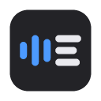

<p align="center"></p>

<h1 align="center">Loah</h1>

<p align="center">
  <b>Talk instead of typing, on macOS, Windows and Linux.</b><br>
  Your words are written into the text field you are in, with the speech recognized on your own computer.<br>
  Loah also records and summarizes meetings, and lets your AI assistant read them.
</p>

<p align="center">
  <a href="https://github.com/henryonai/loah/releases/latest"><b>Download</b></a> ·
  <a href="#download-and-install">Install</a> ·
  <a href="#using-loah">Usage</a> ·
  <a href="#upgrading-from-dictate">Upgrading from Dictate</a> ·
  <a href="#privacy">Privacy</a> ·
  <a href="README.vi.md">Tiếng Việt</a>
</p>

<p align="center">
  
  
  
  <a href="LICENSE"></a>
  <a href="https://github.com/henryonai/loah/releases/latest"></a>
</p>

<p align="center">
  <b>Loah is the new name of Dictate</b>, from version 2.1.0. Your settings, models and library come along:
  see <a href="#upgrading-from-dictate">Upgrading from Dictate</a>.
</p>

## Features

**Dictate into any text field.** Click into a chat box, an email or a document and press the shortcut (`Ctrl+Alt+Space`, `⌃⌥Space` on a Mac; you can change it). Your words show up next to the cursor while you talk. When you stop, Loah writes the text into the field, and, when you have set up an AI, fixes mistakes and punctuation first.

**Rewrite what you just said.** A small chip next to the text has a **⋯** menu for another version: shorter, an email, bullet points, a translation…

**Record and summarize meetings.** Record your screen, one window or just the audio, or add an audio or video file, or a link (YouTube and the other sites that yt-dlp supports). Loah writes the transcript, tells the speakers apart (Speaker 1, 2…) and, when an AI is set up, writes a summary with the decisions and the action items. Timestamps jump to that moment of the recording, and you can ask questions about it.

**Ask your AI assistant about your meetings.** A built-in [MCP server](#ask-claude-about-your-meetings-mcp) (`loah-mcp`) lets Claude Code, Claude Desktop or any MCP client read your recordings.

Speech is recognized on your computer with [Whisper](https://github.com/ggml-org/whisper.cpp): nothing of your voice leaves it unless you choose a transcription API. The interface is available in English and Vietnamese (Settings → General → *Interface language*; by default it follows the system).

## Download and install

Download the installer for your system from [Releases](https://github.com/henryonai/loah/releases/latest). `<version>` in the names is the release number, such as `2.1.0`.

| System | Installer | Checksum file | Needs |
|---|---|---|---|
| macOS, Apple silicon (M1 and later) | `Loah_<version>_aarch64.dmg` | `Loah_<version>_aarch64.dmg.sha256` | macOS 13 or later |
| macOS, Intel | `Loah_<version>_x64.dmg` | `Loah_<version>_x64.dmg.sha256` | macOS 13 or later |
| Windows, 64-bit | `Loah_<version>_x64-setup.exe` | `Loah_<version>_x64-setup.exe.sha256` | Windows 10 or 11 |
| Linux, 64-bit | `Loah_<version>_amd64.deb` | `Loah_<version>_amd64.deb.sha256` | glibc 2.39 or later (Ubuntu 24.04 or later) |

The installers are not signed: read [Unsigned builds](#unsigned-builds) before you open the first one.

### macOS

1. Open the `.dmg` and drag **Loah** to **Applications**. Install it there before you first open it: *Open Loah at login* remembers where the app is.
2. Open it. macOS blocks the first launch of an unsigned app; [Unsigned builds](#unsigned-builds) shows how to allow it.
3. Loah lives in the menu bar (there is no Dock icon). Continue with [First run](#first-run).

### Windows

1. Run the `.exe`. It installs for your user only, with no administrator rights, and offers to start Loah when it is done. The Visual C++ runtime that the app needs comes with it. Windows 11 has the WebView2 runtime that the windows of the app use; on Windows 10 the installer downloads it when it is missing, so it needs a network connection.
2. Windows SmartScreen warns about the unsigned installer: [Unsigned builds](#unsigned-builds) shows how to go on.
3. Loah lives in the notification area of the taskbar (click **^** if you don't see the icon). Continue with [First run](#first-run).

### Linux

The `.deb` is for Ubuntu 24.04 or later. It is built on Ubuntu 24.04, so it needs glibc 2.39 or later; other Debian-family systems with such a glibc (Debian 13, for one) should work too, but are not tested. Install it with `apt`, which also fetches the libraries that Loah needs (replace `<version>` with the version of the file you downloaded, such as `2.1.0`):

```sh
sudo apt install ./Loah_<version>_amd64.deb
```

The package puts `loah` and `loah-mcp` in `/usr/bin` and its own libraries in `/usr/lib/loah`. It recommends `gstreamer1.0-libav` and `gstreamer1.0-plugins-good` (to play recordings), `xdg-desktop-portal` (to record the screen) and `pulseaudio-utils` (to record the sound of the computer), and `apt` installs those with it unless you tell it not to. Start Loah from the application menu or with `loah`. If the package `dictate` is installed, this one replaces it: see [Upgrading from Dictate](#upgrading-from-dictate). The tray icon needs a desktop that shows app indicators (GNOME needs the AppIndicator extension). [Dictation on each system](#dictation-on-each-system) says what Wayland needs.

### Unsigned builds

Loah has no signing certificate yet, so the macOS and Windows installers are neither signed nor notarized. The systems warn you the first time, which is expected. [Verify the download](#verify-the-download) to be sure that the file is the one on the release page.

- **macOS 15 and later:** open Loah once; macOS says it can't check the app. Open **System Settings → Privacy & Security**, scroll down to the message about Loah, click **Open Anyway** and confirm. (On macOS 13 and 14 you can also Control-click the app and choose **Open**.) If macOS says the app "is damaged and can't be opened", remove the flag that marks it as downloaded, and open it again:

  ```sh
  xattr -dr com.apple.quarantine /Applications/Loah.app
  ```

- **Windows:** SmartScreen shows "Windows protected your PC". Click **More info**, then **Run anyway**. On Windows 11 with **Smart App Control** turned on (a new install of Windows 11 may have it on; Settings → Privacy & security → Windows Security → App & browser control → Smart App Control settings shows it) there is no such button: it blocks an unsigned installer outright. Turning it off lets the installer run, but Microsoft does not let you turn it back on without resetting or reinstalling Windows, so think before you do it on a computer you care about.
- **Linux:** nothing to allow.

### Verify the download

Each installer has a checksum file next to it on the release page, with a line of the form `<hash>  <file name>`. Download both into the same folder and check. In each command, replace `<version>` with the version of the files you downloaded (such as `2.1.0`):

```sh
shasum -a 256 -c Loah_<version>_aarch64.dmg.sha256
```

on macOS (use the name of the `.dmg` you downloaded: `_aarch64` for Apple silicon, `_x64` for Intel),

```sh
sha256sum -c Loah_<version>_amd64.deb.sha256
```

on Linux, and on Windows, in PowerShell (with the version of your `.exe` in both file names), which prints `True` when the file is the right one:

```powershell
(Get-FileHash -Algorithm SHA256 .\Loah_<version>_x64-setup.exe).Hash -eq (Get-Content .\Loah_<version>_x64-setup.exe.sha256).Split(' ')[0]
```

A checksum from the same page shows that the download is whole, not who made it. The installers are built by [GitHub Actions](https://github.com/henryonai/loah/actions) from the source of the release.

### Updating

There are no automatic updates yet: download the new installer and install it over the old one (on a Mac, quit Loah and drag the new app over the old one; on Linux, `sudo apt install` the new `.deb`). Your settings, models and library stay where they are. The builds are unsigned, so after an update macOS may take the app for a different one and ask for the permissions again: see [First run](#first-run). Coming from Dictate? Read [Upgrading from Dictate](#upgrading-from-dictate) first.

### Uninstalling

Quit Loah first (the tray or menu bar icon, **Quit**). Your recordings, in the `Loah Meetings` folder of your Documents (or in `Dictate Meetings`, if that is where your library has always been), are never removed.

- **macOS:** drag `Loah.app` from Applications to the Trash. The settings, the models and the saved dictations stay in `~/Library/Application Support/Loah`, and the API keys in Keychain Access (the items whose service is `Loah`).
- **Windows:** Settings → Apps → Installed apps → Loah → Uninstall. The uninstaller removes the program (its files and shortcuts) and none of your data, **and the box "Delete the application data" does not change that:** it removes only the folders that are named after the identifier of the app (`io.github.henryonai.loah`). The downloaded speech models and the saved dictations stay in `%LOCALAPPDATA%\Loah`, the settings in `%APPDATA%\Loah`, and the API keys in Credential Manager (`default.Loah` and `transcribe.Loah`). To remove them too, after the uninstall, in PowerShell:

  ```powershell
  Remove-Item -Recurse -Force "$env:LOCALAPPDATA\Loah", "$env:APPDATA\Loah"
  cmdkey /delete:default.Loah
  cmdkey /delete:transcribe.Loah
  ```

- **Linux:** `sudo apt remove loah` removes the program. The settings (`~/.config/Loah`), the models and the saved dictations (`~/.local/share/Loah`) stay, and so do the API keys in the Secret Service (the Passwords and Keys app). To remove the files too:

  ```sh
  rm -rf ~/.config/Loah ~/.local/share/Loah
  ```

The data of Dictate, if you used it, is not Loah's to remove: see [Upgrading from Dictate](#upgrading-from-dictate) for what stays behind and how to remove a key for good.

## Upgrading from Dictate

Loah is Dictate under a new name, from version 2.1.0. To your system it is a new app, with its own name and identifier (`io.github.henryonai.loah`), so it installs beside Dictate instead of over it (on Linux the package replaces the old one: see below). On its first start Loah brings your things along, and it never changes or deletes anything of Dictate's (the one exception is the login entry that the Linux package swap leaves, described below), so you can go back until you remove Dictate yourself. In short:

1. Install Loah and open it once: it copies what you had.
2. Point your MCP client at Loah.
3. Quit Dictate and remove it.

While Dictate is running, or is set to open at login, Settings → General shows a notice with a button that opens this section: the two apps use the same shortcut and the same meetings folder, so run only one of them.

### What Loah copies from Dictate

On its first start Loah copies the four things that Dictate 2.0 saved, into its own folders ([where they are](#settings)):

- `settings.json`, your settings;
- `whisper-models`, the Whisper models that you downloaded, and `diarization-models`, the speaker separation models: on the same drive they are linked where the file system allows it, which takes no more space, and otherwise copied;
- `Dictations`, your saved dictations.

Nothing else is copied (the files that the Swift app left in the same folder stay where they are). The copy is made once, and after it the two apps keep their own settings: a change in Dictate does not reach Loah. If Dictate was set to open at login, Loah turns on **Open Loah at login** for itself at that first start. Dictate's own login entry stays until you remove Dictate, so until then both start. On Linux that is true only of an entry that starts a Dictate program of its own (one installed in another place, for example): the entry that the package swap leaves behind runs `/usr/bin/dictate`, which is now the script that starts Loah, so Loah removes it, and **Open Loah at login** alone decides whether Loah opens at login.

If an item cannot be copied (a file in use, a full disk), Loah goes on reading Dictate's copy of it, read only, says so in Settings and tries again at the next start. What Loah saves itself (its settings, a model it downloads, a new dictation) always goes to its own folders. So while the copy of the saved dictations has failed, the tray menu's **Open dictations folder** opens Dictate's `Dictations` folder, but new dictations are saved in Loah's `Dictations` folder.

**macOS:** the system sees Loah as a different app, so Microphone, Accessibility and Screen Recording have to be granted again ([First run](#first-run)), and the guide to the Accessibility permission shows again. Remove Dictate from those lists once it is gone.

### Your library, your variables and your keys

- **Meetings library.** If you have a `Dictate Meetings` folder in Documents and no `Loah Meetings` one, Loah and `loah-mcp` go on using `Dictate Meetings`, where it is: nothing is moved or renamed. A new install uses `Loah Meetings`.
- **Environment variables.** `LOAH_MEETINGS_DIR` and `LOAH_FFMPEG` are the names now. `DICTATE_MEETINGS_DIR` and `DICTATE_FFMPEG` are still read when the new one is not set, so an MCP configuration or a shell profile that sets them keeps working.
- **API keys.** The keys are kept in the credential store of your system under the service `Loah` (on Windows, the entries `default.Loah` and `transcribe.Loah`). The first time Loah needs a key that it does not have, it copies Dictate's key (the service `Dictate`; on Windows `default.Dictate` and `transcribe.Dictate`) and leaves Dictate's entry where it is. On a Mac, Keychain may ask whether Loah can use the item that Dictate saved: choose **Allow**. If you choose **Deny**, Loah goes on as if it had no key (it says to add one) and asks again at the next start; you can also type the key again in Settings. Clearing a key in Settings → *Accounts & API keys* removes it in Loah and leaves Dictate's entry alone.

To remove a key completely by hand, remove **both** entries, Loah's and Dictate's: if Dictate's is left, Loah copies the key back the next time it needs it. On Windows, in PowerShell:

```powershell
cmdkey /delete:default.Loah
cmdkey /delete:default.Dictate
cmdkey /delete:transcribe.Loah
cmdkey /delete:transcribe.Dictate
```

On a Mac, delete the items whose service is `Loah` and `Dictate` in Keychain Access; on Linux, the two entries in the Passwords and Keys app.

### Pointing your MCP client at Loah, and removing Dictate

The server has a new path. Keep the name that your client uses for it, `dictate`, and the tool names that your prompts already use stay the same; use `loah` as the name for a new setup ([Ask Claude about your meetings](#ask-claude-about-your-meetings-mcp)).

| System | Dictate's server | Loah's server |
|---|---|---|
| macOS | `/Applications/Dictate.app/Contents/MacOS/dictate-mcp` | `/Applications/Loah.app/Contents/MacOS/loah-mcp` |
| Windows | `%LOCALAPPDATA%\Dictate\dictate-mcp.exe` | `%LOCALAPPDATA%\Loah\loah-mcp.exe` |
| Linux | `/usr/bin/dictate-mcp` | `/usr/bin/loah-mcp` |

- **macOS.** Re-point Claude Code (an entry that exists has to be removed before it is added again). If the first command says that no MCP server is named `dictate`, go on to the next line:

  ```sh
  claude mcp remove dictate
  claude mcp add --scope user dictate -- /Applications/Loah.app/Contents/MacOS/loah-mcp
  ```

  In Claude Desktop, change the `command` of the `dictate` entry in `claude_desktop_config.json` to the new path and restart Claude. Then quit Dictate (the menu bar icon → Quit) and drag `/Applications/Dictate.app` to the Trash: the Loah installer does not touch it.
- **Windows.** Loah installs beside Dictate (an installer for one user cannot safely remove another program), and `%LOCALAPPDATA%\Dictate\dictate-mcp.exe` keeps working until you uninstall Dictate. Re-point Claude Code, in PowerShell:

  ```powershell
  claude mcp remove dictate
  claude mcp add --scope user dictate -- "$env:LOCALAPPDATA\Loah\loah-mcp.exe"
  ```

  In Claude Desktop, change the `command` of the `dictate` entry to the new path (with every backslash written twice) and restart Claude. Then quit Dictate and uninstall it: Settings → Apps → Installed apps → Dictate → Uninstall.
- **Linux.** Installing the Loah `.deb` replaces the `dictate` package, and `/usr/bin/dictate-mcp` and `/usr/bin/dictate` keep working: they are small scripts that start `loah-mcp` and `loah`, so an MCP client set up for Dictate and a key bound to `dictate --toggle` go on as they were. They stay for the 2.x versions and go in a later major version, which the release notes will announce, so point your client at `loah-mcp` when you can:

  ```sh
  claude mcp remove dictate
  claude mcp add --scope user dictate -- loah-mcp
  ```

Removing Dictate leaves its data on the disk: its folders (the same as Loah's, named `Dictate`; see [Uninstalling](#uninstalling)) and its keys. Loah has its own copy, so delete them whenever you like, once Settings shows no note about a copy that failed. Take out the keys of both apps together when you want them gone (see above).

### If you used the Swift Dictate (1.x) on macOS

The older Swift app is a different program with the same name as the one that Loah replaces. Loah installs beside it and does not use its files:

1. **Quit the old one first** (menu bar icon → Quit).
2. Install Loah and grant the permissions ([First run](#first-run)). The settings and API keys of the old app are not carried over: enter them again in Settings.
3. Point your MCP client at Loah, as above, and drag the old `Dictate.app` to the Trash.

The old app's own files stay where they were and Loah does not use them: the WhisperKit models in `~/Library/Application Support/Dictate/Models` and the recordings of its dictation in `Recordings` next to them. You can delete both folders to free the space. What stays: your library (the `Dictate Meetings` folder in Documents has the same format, and the recordings of the old app open as they are). What is gone: Apple Speech and WhisperKit. Speech is recognized with Whisper models that you download again in Settings.

## First run

1. **Permissions (macOS).** Settings → General → *Permissions* shows each one, with a button that asks for it or opens the right pane of System Settings:

   | Permission | Used for | When |
   |---|---|---|
   | Microphone | Dictation and the microphone of a recording | Asked the first time you dictate |
   | Accessibility | Finding the text field you are in and pasting the text there. Without it, the text comes out in a card to edit and copy | Settings → General → Permissions → *Grant access…* |
   | Screen Recording | Recording the screen and the sound of the computer, even with *Audio only* | Asked at the first screen recording; reopen Loah after you turn it on |

   Windows and Linux ask for nothing at install time: see [Dictation on each system](#dictation-on-each-system) for what each one needs.

2. **Choose a Whisper model.** Settings → *Speech recognition* → *Whisper models*: click **Download** next to the one marked *Recommended* (it depends on the memory of the computer; **Tiny** and **Base** are weak for Vietnamese, **Small** and larger are better). The model is downloaded once, from Hugging Face, and speech is then recognized offline. Until a model is there, dictation says so.
3. **Optional: add an OpenRouter key**, for the editing of dictation and for summaries. Loah uses [OpenRouter](https://openrouter.ai) with the model `deepseek/deepseek-v4.1-flash` by default, so there is no URL or model to type: create a key at [openrouter.ai/keys](https://openrouter.ai/keys), then Settings → *Accounts & API keys* → *AI*, paste it and click **Check**. Choosing OpenRouter for the *Transcription API* too needs no second key: it uses the same one.

   To use another service, choose it under *Provider* and enter its base URL, a model it has and your key:
   - **Anthropic:** base URL `https://api.anthropic.com`, a model such as `claude-haiku-5-5` (fast) or `claude-sonnet-5-5`.
   - **OpenAI-compatible:** OpenRouter with another model (such as `anthropic/claude-haiku-5.5`), OpenAI, or a local server such as Ollama (`http://localhost:11434/v1`).

   API keys go to the credential store of your system (Keychain, Credential Manager, Secret Service), never to a file. Without an AI, dictation still works, the text is just not edited, and a recording gets a transcript and no summary.
4. **Choose the language of your dictation:** Settings → *General* → *Dictation* → *Language* (it starts as English (US); choose *Tiếng Việt* to speak Vietnamese).
5. **Click into any text field, press the shortcut, talk, and press it again.**

## Using Loah

### Dictation

| Action | Key |
|---|---|
| Start / stop dictating | `Ctrl+Alt+Space` (`⌃⌥Space` on a Mac); change it in Settings → General, which also has a hold-to-talk mode |
| Write it as it is, skipping the AI edit | press the shortcut again while the bubble says "Editing: …" |
| Another version of what was just written | click **⋯** on the chip next to it |
| Cancel while talking | `Esc` |
| On the card (when no text field has the focus): edit styles | `Ctrl+1–5` (`⌘1–5` on a Mac) |

**Writing into text fields** (Settings → General → *Write into the focused text field*, on by default): while you talk, a bubble with the live text sits next to the cursor. When you finish, Loah fixes mistakes and punctuation with your AI (the default style is in the *AI editing & summaries* tab) and pastes the result into the field. After that, a small chip stays by the text for a few seconds: its **⋯** menu rewrites the text in place (shorter, an email, bullet points, formal, an AI prompt, a translation into English or Vietnamese, the original, a request of your own). Typing, clicking elsewhere or switching apps makes the chip go away, and Loah leaves the field alone from then on.

With no text field focused, or with that setting off, a card opens to edit and copy the text. Add names and terms to *Custom vocabulary / context* (Settings → *AI editing & summaries*) so that the AI spells them right.

**Saved dictations.** With *Save recordings + transcripts* on (the default), the audio and the text of each dictation are kept in `Loah/Dictations` in your local data folder (the tray menu opens it). A dictation that is not saved leaves nothing behind.

#### Dictation on each system

- **macOS:** dictation needs the Microphone and Accessibility permissions (see [First run](#first-run)). The app is not signed, so after a rebuild or an update Accessibility may need granting again: remove Loah from the list in System Settings → Privacy & Security → Accessibility and add it again.
- **Windows:** an app that runs as administrator can't be pasted into by a normal app: Loah copies the text and the card says so, and you press `Ctrl+V`. If the microphone only records silence, check Settings → Privacy & security → Microphone and let desktop apps use it.
- **Linux:** X11 works. On Wayland no app can press keys in another one, so install `wtype` (wlroots desktops such as Sway, and Hyprland) or `ydotool` so that Loah can paste; without either, the text is copied and you press `Ctrl+V`. The shortcut comes from the desktop's GlobalShortcuts portal (KDE Plasma, GNOME 48 and later, Hyprland); where there is none (Sway and other wlroots desktops), bind a key in the desktop's settings to run `loah --toggle`.

`loah --toggle` does what pressing the shortcut once does, also when the app is not running yet, and `loah --record` does the same for a recording. The program is not on the path of every system:

| System | Program to run |
|---|---|
| macOS | `/Applications/Loah.app/Contents/MacOS/loah` |
| Windows | `%LOCALAPPDATA%\Loah\loah.exe` |
| Linux | `loah` |

### Meetings, videos and links

The tray menu's **Meetings…** opens the library: add a recording and Loah makes a transcript, tells the speakers apart (Speaker 1, 2…) and, when an AI is set up, writes a summary with key points, decisions, action items to tick and chapters. Each line carries the time it is based on, and a click on it jumps to that moment of the recording; audio plays in a slim bar, video in a box that you can enlarge or hide. Ask a question about a recording, rename the speakers, export the Markdown, or move a recording to the Trash (Recycle Bin).

- **Importing.** Choose audio or video files, drag them onto the window, or paste a link (YouTube or any site that yt-dlp supports) with `Ctrl+V` / `⌘V` anywhere in the window. **The files you add are not copied or moved:** the recording keeps pointing at the original, so keep it where it is. If it is moved or deleted, the transcript and the summary stay, and playback says the file is gone.
- **The library folder** is `Loah Meetings` in your Documents folder (a library that Dictate made stays in `Dictate Meetings`, where it is: see [Upgrading from Dictate](#upgrading-from-dictate)), with one folder per recording, named by its start time, and `transcript.txt`, `summary.md`, `tasks.json`, `log.txt` and `meta.json` in it. The library of the old Swift app has the same format. Set `LOAH_MEETINGS_DIR` (a leading `~` means your home folder) before you start the app to use another folder, for example to try it out without touching your real library; `loah-mcp` reads the same variable. `DICTATE_MEETINGS_DIR`, the name that Dictate used, is still read when `LOAH_MEETINGS_DIR` is not set.
- **Speech to text.** Local Whisper by default; the **Transcription API** (OpenRouter, OpenAI, Groq or your own endpoint) is an option for files and for dictation (Settings → *Speech recognition* and *Accounts & API keys*). The first time speakers are separated, Loah downloads two models (about 46 MB).
- **Playback on Linux** needs the GStreamer libav plugin, which the `.deb` recommends: `sudo apt install gstreamer1.0-libav gstreamer1.0-plugins-good`. Without it the window says what to install; the transcript and the summary work all the same.

### Recording

The tray menu's **Record & summarize…** (and the **Record** button of the Meetings window) opens a picker. Choose what to record and press **Start recording**; when you stop, the recording goes through the same steps as an imported file: transcript, speakers and, when an AI is set up, a summary.

- **What each mode records.** *Full screen* is a display, with the sound of the computer and your microphone (with several displays the picker lets you choose; the main one is the default). *Single window* is one window, until you stop or close it. *Audio only* is sound without a picture. In every mode the sound of the computer and the microphone can each be turned off (not both in *Audio only*). *Video quality* is **Small** (10 frames a second, up to 1280 px on the long side), **Standard** (15, up to 1920; the default) or **Sharp** (30, up to 3840). The picker keeps the mode, the quality and the two sounds for next time.
- **The bar.** While a recording goes on, a small bar at the top of the screen shows the time and a meter for each sound, with **Pause** and **Resume**, **Stop & summarize** and **Discard**. Drag it by its capsule to move it; it never takes the focus.
- **The shortcut.** `Ctrl+Alt+R` (`⌃⌥R` on a Mac) starts and stops a recording from anywhere, with the choices of the last time. When the last mode was *Single window*, it opens the picker instead, because the window is not remembered. On a Wayland desktop with no GlobalShortcuts portal, bind a key in the desktop's settings to run `loah --record`.
- **When something goes wrong.** If you unplug the headphones or the microphone, the recording goes on with the device that the system has now (what came between is silence) and the bar says "reconnected". If the window you record is closed, the display goes away or the permission is turned off, the recording ends by itself, what was recorded is kept and processed, and a notification says why. If Loah is ended in the middle of a recording by a crash, the next start finishes it from what is on the disk and loses at most about the last second (two seconds of the picture), and the log says that it was interrupted. A power cut can lose more, because the files are not forced to the disk with `fsync`, so what the system had not written yet is gone. **Quit** in the tray menu while recording saves the recording first (it waits for up to a minute) and then quits.
- **Where it goes.** A recording is a folder of the library like the others, with the video (`recording.mp4`, or `recording.webm` on Linux, where VP9 is the first choice), `audio.m4a` and the rest. Unlike an imported file, it lives in the library.
- **macOS** 13 or later. Recording the screen **and the sound of the computer, even in *Audio only*,** needs the Screen Recording permission (Settings → General → Permissions shows it; reopen Loah after turning it on). macOS 15 and later ask again from time to time whether Loah may keep recording the screen: allow it. The recording leaves out all of Loah's own windows, the bar included. In *Single window* mode the sound of the computer is only what the app of that window plays: choose *Full screen* to record every sound.
- **Windows:** the bar, the Meetings window and Settings are kept out of the video on Windows 10 version 2004 or later; the windows of dictation (the bubble and the card) are not.
- **Linux:** the screen comes from the desktop's ScreenCast portal, so you need `xdg-desktop-portal` and the backend of your desktop (GNOME, KDE Plasma, Hyprland, or `xdg-desktop-portal-wlr` for Sway and other wlroots desktops), on Wayland and X11 alike, and PipeWire (`libpipewire-0.3-0`; a desktop that has PipeWire has it). The desktop's own dialog asks what to share. The sound of the computer is recorded with `parec`, from `pulseaudio-utils`. Linux has no way to leave Loah's own windows out of the video, so they can appear in it, the bar too.

### yt-dlp and ffmpeg

**ffmpeg is included.** Loah comes with a build of [FFmpeg](https://ffmpeg.org) under the LGPL, called `loah-ffmpeg` and kept next to the program. It reads the formats that Loah can't open by itself, encodes the video of a recording and helps yt-dlp. You install nothing for it. Settings → *Speech recognition* → *Tools for links* shows what Loah found.

**yt-dlp is not included.** A link needs [yt-dlp](https://github.com/yt-dlp/yt-dlp), which you install yourself: Loah finds it on the path and in the usual folders of your package manager.

| System | Install yt-dlp |
|---|---|
| macOS | `brew install yt-dlp` |
| Windows | `winget install yt-dlp.yt-dlp` |
| Linux | `pipx install yt-dlp` |

**Using your own ffmpeg.** The LGPL lets you replace the ffmpeg that comes with Loah. Loah looks for ffmpeg in this order: the program named by the `LOAH_FFMPEG` environment variable (a path, or a name on the path; `DICTATE_FFMPEG`, the name that Dictate used, is still read when `LOAH_FFMPEG` is not set), then `loah-ffmpeg` next to the program, then `ffmpeg` on the path. A value that is empty, or that names a program that cannot run, is ignored. A program that is started from the desktop does not see everything that your terminal sees, so set the variable where the app will read it:

- **macOS:** an app that you open from Finder or the Dock does not see the variables of your shell. Set it for the session with `launchctl setenv`, then quit Loah and open it again (the setting lasts until you restart the Mac), or start Loah from a terminal with the variable set:

  ```sh
  launchctl setenv LOAH_FFMPEG /path/to/ffmpeg
  ```

- **Windows:** make it an environment variable of your user (search the Start menu for "Edit environment variables for your account", or use `setx` in a terminal), then quit Loah and open it again:

  ```powershell
  setx LOAH_FFMPEG "C:\path\to\ffmpeg.exe"
  ```

- **Linux:** put it in the environment of the desktop session (for example a file in `~/.config/environment.d/` on a systemd desktop, and log in again), or start Loah from a terminal with it set:

  ```sh
  LOAH_FFMPEG=/path/to/ffmpeg loah
  ```

### Ask Claude about your meetings (MCP)

Loah comes with `loah-mcp`, a read-only MCP server. With it, Claude Code and Claude Desktop read the recordings of your library: ask "what did we decide in yesterday's meeting?" or "what's still on my plate?". Claude finds the recordings, reads their summaries and quotes the transcript with `[mm:ss]` timestamps.

| Tool | What it does |
|---|---|
| `list_meetings` | Recordings, newest first: date, length, open action items, the start of the summary. Filter by date or keyword |
| `get_meeting` | The full summary of one recording, with which action items were ticked off in Loah |
| `get_transcript` | The transcript, or a time range of it (`start`/`end`); long ones come back in parts |
| `search_meetings` | Searches titles, summaries and transcripts, ignoring case and Vietnamese diacritics: "hop" finds "họp" |
| `list_action_items` | Action items across all recordings, filtered by owner, status (open / done) and date |

Where the server is, by system:

| System | Path |
|---|---|
| macOS | `/Applications/Loah.app/Contents/MacOS/loah-mcp` |
| Windows | `%LOCALAPPDATA%\Loah\loah-mcp.exe` (the folder that the installer used for your user; if you chose another one, use that) |
| Linux (`.deb`) | `/usr/bin/loah-mcp` |

Run it in a terminal and it prints the command for the place where it is. **Claude Code:**

```sh
claude mcp add --scope user loah -- /Applications/Loah.app/Contents/MacOS/loah-mcp
```

On Windows, in PowerShell:

```powershell
claude mcp add --scope user loah -- "$env:LOCALAPPDATA\Loah\loah-mcp.exe"
```

On Linux, where it is on the path:

```sh
claude mcp add --scope user loah -- loah-mcp
```

**Claude Desktop:** Settings → Developer → Edit Config, add `loah` to `mcpServers` in `claude_desktop_config.json`, then restart Claude:

```json
{
  "mcpServers": {
    "loah": { "command": "/Applications/Loah.app/Contents/MacOS/loah-mcp" }
  }
}
```

On Windows the command is the path above, with every backslash written twice in JSON:

```json
{
  "mcpServers": {
    "loah": { "command": "C:\\Users\\<you>\\AppData\\Local\\Loah\\loah-mcp.exe" }
  }
}
```

The library lives in your Documents folder, so on a Mac the first time macOS may ask whether Claude (or the terminal app that runs Claude Code) can access it: choose Allow. The server only reads; it never changes or deletes anything. `LOAH_MEETINGS_DIR` points the server at another library (the app too), and `DICTATE_MEETINGS_DIR` still does when it is not set. Already using Dictate's server? [Upgrading from Dictate](#upgrading-from-dictate) says how to point your client at this one and keep the tool names. The server speaks both generations of the MCP protocol: the current one (2026-07-28, where every request carries its version in `_meta`) and the `initialize` handshake of 2025-11-25 and earlier.

## Settings

Open Settings from the tray icon → *Settings…*.

- **General:** the language of the interface, the theme (System, Light or Dark: every window follows it at once, the dictation panel and the recording bar too), opening at login, the dictation language, the shortcut, press or hold mode, writing into the focused text field, saving dictations, the permissions (on a Mac), the shortcut of the recording, the meetings folder, and a link to the licenses.
- **Speech recognition:** the engine for dictation and for files (local Whisper or a transcription API), the transcription language, separating speakers, the Whisper models and the tools for links.
- **AI editing & summaries:** the default editing style, editing automatically when you finish, the summary model and your custom vocabulary.
- **Accounts & API keys:** the AI provider and the transcription service, each with a **Check** button.

Where Loah keeps things:

| | macOS | Windows | Linux |
|---|---|---|---|
| Settings | `~/Library/Application Support/Loah/settings.json` | `%APPDATA%\Loah\settings.json` | `~/.config/Loah/settings.json` |
| Whisper and speaker models, saved dictations | `~/Library/Application Support/Loah/` | `%LOCALAPPDATA%\Loah\` | `~/.local/share/Loah/` |
| Meetings library | `~/Documents/Loah Meetings` | `Documents\Loah Meetings` | `~/Documents/Loah Meetings` |
| API keys | Keychain | Credential Manager | Secret Service |

A library that Dictate made stays in `Dictate Meetings` and is used from there; see [Upgrading from Dictate](#upgrading-from-dictate).

## Privacy

Loah has no account, analytics or telemetry. It only talks to the services you set up, to the site of a link you add (through yt-dlp), to Hugging Face and GitHub to download models (the Whisper models and the two speaker separation models) and, on a Windows 10 that has no WebView2, to Microsoft when the installer downloads it. The picture and the sound of a recording are played back by a small server inside the app that listens on `127.0.0.1` only, with a random token in the address.

- **Stays on your computer:** recordings, transcripts and summaries (in the folders above), and Whisper, which recognizes the speech here. API keys are in the credential store of your system.
- **Sent to your AI provider** (OpenRouter unless you chose another): the text you dictate when it is edited or rewritten, and the transcript of a recording when it is summarized or you ask about it. A local endpoint such as Ollama keeps this on your computer too.
- **Sent to your transcription API,** only when you choose the API as the engine: the audio of a dictation or of a recording.
- **Read by Claude,** through the MCP server: the content of a recording, when Claude reads it.

## Third-party software

Loah is built on the work of others: whisper.cpp and the Whisper models, sherpa-onnx and ONNX Runtime, the pyannote and NeMo speaker models, Tauri, Svelte and many Rust libraries. The installers also carry [FFmpeg](https://ffmpeg.org), under the GNU LGPL version 2.1 or later. [THIRD_PARTY_NOTICES.md](THIRD_PARTY_NOTICES.md) lists all of them with their licenses, has the written offer of the FFmpeg source, and says how the FFmpeg that comes with Loah was built and how to replace it. Every release has the FFmpeg source and the lines it was configured with attached to it. Settings → General has a **Licenses** link to the same file.

The license files go with every installer: `LICENSE`, `THIRD_PARTY_NOTICES.md`, `THIRD_PARTY_LICENSES.txt` (the full license texts and copyright lines of everything in Loah, each Rust crate and npm package included) and `COPYING.LGPLv2.1` (the text of the LGPL for FFmpeg). On macOS they are in `Loah.app/Contents/Resources/Licenses` (in Finder, right-click the app and choose *Show Package Contents*); on Windows, in the `Licenses` folder next to `loah.exe` (`%LOCALAPPDATA%\Loah\Licenses`); on Linux, in `/usr/share/doc/loah`.

## Contributing

Bug reports, ideas and pull requests are welcome: open an [issue](https://github.com/henryonai/loah/issues/new/choose). [CONTRIBUTING.md](CONTRIBUTING.md) explains how to build, test, translate the interface and write commits, and [app/README.md](app/README.md) is the developer guide of the app. Everyone taking part follows the [Code of Conduct](CODE_OF_CONDUCT.md). Please report security problems privately, as described in [SECURITY.md](SECURITY.md).

## License

[MIT](LICENSE) © 2026 Henry Hoang
