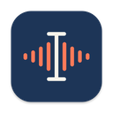

<p align="center"></p>

<h1 align="center">Dictate</h1>

<p align="center">
  <b>Nói thay vì gõ, trên macOS, Windows và Linux.</b><br>
  Lời bạn nói được viết thẳng vào ô chữ đang chọn, và giọng nói được nhận dạng ngay trên máy của bạn.<br>
  Dictate còn ghi và tóm tắt cuộc họp, và cho trợ lý AI của bạn đọc lại chúng.
</p>

<p align="center">
  <a href="https://github.com/henryonai/dictate/releases/latest"><b>Tải về</b></a> ·
  <a href="#tải-về-và-cài-đặt">Cài đặt</a> ·
  <a href="#cách-dùng">Cách dùng</a> ·
  <a href="#quyền-riêng-tư">Quyền riêng tư</a> ·
  <a href="README.md">English</a>
</p>

<p align="center">
  
  
  
  <a href="LICENSE"></a>
  <a href="https://github.com/henryonai/dictate/releases/latest"></a>
</p>

## Tính năng

**Đọc vào bất kỳ ô chữ nào.** Bấm vào ô chat, email hay tài liệu rồi nhấn phím tắt (`Ctrl+Alt+Space`, trên Mac là `⌃⌥Space`; đổi được). Chữ hiện cạnh con trỏ trong lúc bạn nói. Nói xong, Dictate viết đoạn chữ vào ô, và nếu bạn đã cài một AI thì sửa chữ nghe nhầm và dấu câu trước.

**Viết lại câu vừa nói.** Chip nhỏ cạnh đoạn chữ có menu **⋯** để có bản khác: ngắn hơn, thành email, gạch đầu dòng, bản dịch…

**Ghi và tóm tắt cuộc họp.** Quay màn hình, một cửa sổ hoặc chỉ ghi âm, hoặc thêm file âm thanh, file video, hay link (YouTube và các trang khác yt-dlp hỗ trợ). Dictate viết transcript, tách người nói (Speaker 1, 2…) và, khi đã cài AI, viết bản tóm tắt kèm các quyết định và việc cần làm. Bấm mốc thời gian để nhảy tới đúng đoạn đó, và hỏi thêm về bản ghi.

**Hỏi trợ lý AI về cuộc họp.** [MCP server](#hỏi-claude-về-cuộc-họp-mcp) có sẵn trong app (`dictate-mcp`) cho Claude Code, Claude Desktop hay bất kỳ MCP client nào đọc các bản ghi của bạn.

Giọng nói được nhận dạng trên máy bằng [Whisper](https://github.com/ggml-org/whisper.cpp): giọng của bạn không rời khỏi máy trừ khi bạn chọn dùng API transcript. Giao diện có tiếng Việt và tiếng Anh (Cài đặt → Chung → *Ngôn ngữ giao diện*; mặc định theo hệ thống).

## Tải về và cài đặt

Tải bộ cài cho hệ thống của bạn ở mục [Releases](https://github.com/henryonai/dictate/releases/latest). `<version>` trong tên file là số phiên bản, ví dụ `2.0.0`.

| Hệ thống | Bộ cài | File checksum | Yêu cầu |
|---|---|---|---|
| macOS, chip Apple (M1 trở lên) | `Dictate_<version>_aarch64.dmg` | `Dictate_<version>_aarch64.dmg.sha256` | macOS 13 trở lên |
| macOS, chip Intel | `Dictate_<version>_x64.dmg` | `Dictate_<version>_x64.dmg.sha256` | macOS 13 trở lên |
| Windows, 64-bit | `Dictate_<version>_x64-setup.exe` | `Dictate_<version>_x64-setup.exe.sha256` | Windows 10 hoặc 11 |
| Linux, 64-bit | `Dictate_<version>_amd64.deb` | `Dictate_<version>_amd64.deb.sha256` | glibc 2.39 trở lên (Ubuntu 24.04 trở lên) |

Các bộ cài chưa được ký: đọc [Bản phát hành chưa ký](#bản-phát-hành-chưa-ký) trước khi mở bộ cài đầu tiên.

### macOS

1. Mở file `.dmg` rồi kéo **Dictate** vào **Applications**. Hãy cài vào đó trước khi mở lần đầu: tính năng *Tự mở Dictate khi khởi động máy* nhớ vị trí của app.
2. Mở app. macOS chặn lần mở đầu tiên của app chưa ký; cách cho phép nằm ở [Bản phát hành chưa ký](#bản-phát-hành-chưa-ký).
3. Dictate chạy trên menu bar (không có icon ở Dock). Làm tiếp theo mục [Lần chạy đầu tiên](#lần-chạy-đầu-tiên).

### Windows

1. Chạy file `.exe`. Bộ cài chỉ cài cho tài khoản của bạn, không cần quyền administrator, và hỏi có mở Dictate khi cài xong không. Thư viện Visual C++ mà app cần đã đi kèm. Windows 11 có sẵn WebView2 mà cửa sổ của app dùng; trên Windows 10, nếu máy chưa có thì bộ cài tải về, nên cần có mạng.
2. Windows SmartScreen cảnh báo bộ cài chưa ký: cách đi tiếp nằm ở [Bản phát hành chưa ký](#bản-phát-hành-chưa-ký).
3. Dictate chạy ở vùng thông báo của thanh taskbar (bấm **^** nếu chưa thấy icon). Làm tiếp theo mục [Lần chạy đầu tiên](#lần-chạy-đầu-tiên).

### Linux

File `.deb` dành cho Ubuntu 24.04 trở lên. Nó được build trên Ubuntu 24.04 nên cần glibc 2.39 trở lên; các hệ Debian khác có glibc như vậy (ví dụ Debian 13) chắc cũng chạy được nhưng chưa được thử. Cài bằng `apt`, apt sẽ tải luôn các thư viện Dictate cần:

```sh
sudo apt install ./Dictate_<version>_amd64.deb
```

Gói cài đặt đặt `dictate` và `dictate-mcp` vào `/usr/bin`, thư viện riêng của app vào `/usr/lib/dictate`. Gói đề xuất thêm `gstreamer1.0-libav` và `gstreamer1.0-plugins-good` (để phát bản ghi), `xdg-desktop-portal` (để quay màn hình) và `pulseaudio-utils` (để ghi âm thanh của máy); `apt` cài các gói này cùng, trừ khi bạn bảo nó đừng. Mở Dictate từ menu ứng dụng hoặc bằng lệnh `dictate`. Icon trên khay cần desktop có hiện app indicator (GNOME cần extension AppIndicator). Mục [Đọc chính tả trên từng hệ điều hành](#đọc-chính-tả-trên-từng-hệ-điều-hành) nói Wayland cần gì.

### Bản phát hành chưa ký

Dictate chưa có chứng chỉ ký, nên bộ cài macOS và Windows chưa được ký và chưa được notarize. Hệ thống sẽ cảnh báo ở lần mở đầu tiên, đó là chuyện bình thường. Hãy [kiểm tra bản tải về](#kiểm-tra-bản-tải-về) để chắc rằng file đúng là file trên trang phát hành.

- **macOS 15 trở lên:** mở Dictate một lần; macOS báo không kiểm tra được app. Vào **System Settings → Privacy & Security**, kéo xuống dòng báo về Dictate, bấm **Open Anyway** rồi xác nhận. (Trên macOS 13 và 14 còn có cách giữ Control rồi bấm vào app và chọn **Open**.) Nếu macOS báo app "bị hỏng" (damaged), hãy gỡ cờ đánh dấu file tải về rồi mở lại:

  ```sh
  xattr -dr com.apple.quarantine /Applications/Dictate.app
  ```

- **Windows:** SmartScreen hiện "Windows protected your PC". Bấm **More info**, rồi **Run anyway**.
- **Linux:** không cần cho phép gì.

### Kiểm tra bản tải về

Mỗi bộ cài có một file checksum ngay cạnh trên trang phát hành, một dòng dạng `<hash>  <tên file>`. Tải cả hai vào cùng một thư mục rồi kiểm tra:

```sh
shasum -a 256 -c Dictate_<version>_aarch64.dmg.sha256
```

trên macOS (dùng tên file `.dmg` bạn đã tải),

```sh
sha256sum -c Dictate_<version>_amd64.deb.sha256
```

trên Linux, và trên Windows, trong PowerShell, lệnh này in `True` khi file đúng:

```powershell
(Get-FileHash -Algorithm SHA256 .\Dictate_<version>_x64-setup.exe).Hash -eq (Get-Content .\Dictate_<version>_x64-setup.exe.sha256).Split(' ')[0]
```

Checksum lấy từ cùng một trang chỉ cho biết file tải về còn nguyên vẹn, không cho biết ai làm ra nó. Các bộ cài được [GitHub Actions](https://github.com/henryonai/dictate/actions) build từ mã nguồn của chính bản phát hành đó.

### Cập nhật

Chưa có cập nhật tự động: hãy tải bộ cài mới rồi cài đè lên bản cũ (trên Mac, thoát Dictate rồi kéo app mới đè lên app cũ; trên Linux, `sudo apt install` file `.deb` mới). Cài đặt, model và thư viện cuộc họp của bạn vẫn nằm nguyên chỗ cũ. Các bản build chưa ký, nên sau khi cập nhật macOS có thể xem app là một app khác và hỏi lại các quyền: xem [Lần chạy đầu tiên](#lần-chạy-đầu-tiên).

### Thay bản Dictate viết bằng Swift trên macOS

App này thay cho Dictate cũ viết bằng Swift (các bản 1.x). Nó cùng tên và cùng chỗ cài, nên bạn cài như một lần cập nhật:

1. **Thoát app cũ trước** (icon trên menu bar → Quit).
2. Kéo `Dictate.app` mới vào `/Applications` rồi chọn **Replace**.
3. Cấp lại các quyền: macOS thấy đây là app khác, nên Microphone, Accessibility và Screen Recording phải bật lại ([Lần chạy đầu tiên](#lần-chạy-đầu-tiên)). Cài đặt và API key cũng không được chuyển sang: hãy nhập lại trong Cài đặt.

Những gì giữ nguyên: thư viện của bạn (thư mục `Dictate Meetings` trong Documents cùng định dạng, các bản ghi của app cũ mở được như thường) và đường dẫn của MCP server, `/Applications/Dictate.app/Contents/MacOS/dictate-mcp`, nên Claude Code và Claude Desktop vẫn chạy mà không phải đổi gì. Những gì không còn: Apple Speech và WhisperKit. Giọng nói được nhận dạng bằng các model Whisper, bạn tải lại trong Cài đặt.

## Lần chạy đầu tiên

1. **Quyền truy cập (macOS).** Cài đặt → Chung → *Quyền truy cập* cho thấy từng quyền, kèm nút xin quyền hoặc mở đúng mục của System Settings:

   | Quyền | Dùng để | Khi nào |
   |---|---|---|
   | Microphone | Đọc chính tả và micro khi quay | Hỏi ngay lần đọc chính tả đầu tiên |
   | Accessibility | Tìm ô chữ bạn đang chọn và dán chữ vào đó. Chưa cấp thì chữ hiện trong thẻ để bạn sửa và sao chép | Cài đặt → Chung → Quyền truy cập → *Cấp quyền…* |
   | Screen Recording | Quay màn hình và ghi âm thanh của máy, kể cả khi chỉ ghi âm | Hỏi ở lần quay màn hình đầu tiên; bật xong cần mở lại Dictate |

   Windows và Linux không hỏi quyền nào lúc cài: xem [Đọc chính tả trên từng hệ điều hành](#đọc-chính-tả-trên-từng-hệ-điều-hành) để biết mỗi hệ cần gì.

2. **Chọn model Whisper.** Cài đặt → *Nhận dạng giọng nói* → *Model Whisper*: bấm **Tải** ở model được đánh dấu *Đề xuất* (tuỳ theo dung lượng RAM của máy; **Tiny** và **Base** kém tiếng Việt, từ **Small** trở lên tốt hơn). Model chỉ tải một lần, từ Hugging Face, sau đó giọng nói được nhận dạng offline. Chưa có model thì khi đọc chính tả app sẽ báo.
3. **Tuỳ chọn: cài một AI** để sửa chữ khi đọc chính tả và để tóm tắt. Cài đặt → *Tài khoản & API key* → *AI*, rồi bấm **Kiểm tra**:
   - **Anthropic:** base URL `https://api.anthropic.com`, một model như `claude-haiku-5-5` (nhanh) hoặc `claude-sonnet-5-5`, cùng API key của bạn.
   - **Tương thích OpenAI:** OpenRouter (`https://openrouter.ai/api/v1`), OpenAI, hoặc server chạy trên máy như Ollama (`http://localhost:11434/v1`), kèm tên một model mà endpoint đó có.

   API key được lưu trong kho credential của hệ thống (Keychain, Credential Manager, Secret Service), không bao giờ nằm trong file. Chưa có AI thì đọc chính tả vẫn chạy, chỉ là chữ không được sửa, và bản ghi chỉ có transcript, không có tóm tắt.
4. **Chọn ngôn ngữ đọc:** Cài đặt → *Chung* → *Đọc chính tả* → *Ngôn ngữ* (mặc định là English (US); nói tiếng Việt thì chọn *Tiếng Việt*).
5. **Bấm vào một ô chữ bất kỳ, nhấn phím tắt, nói, rồi nhấn lại lần nữa.**

## Cách dùng

### Đọc chính tả

| Thao tác | Phím |
|---|---|
| Bắt đầu / dừng đọc | `Ctrl+Alt+Space` (trên Mac là `⌃⌥Space`); đổi trong Cài đặt → Chung, nơi cũng có chế độ giữ phím để nói |
| Viết luôn, bỏ qua bước AI sửa | nhấn phím tắt lần nữa khi bong bóng đang “Đang sửa: …” |
| Kiểu khác cho đoạn vừa viết | bấm **⋯** trên chip cạnh đoạn đó |
| Huỷ khi đang nói | `Esc` |
| Trên thẻ (khi không có ô chữ nào đang chọn): các kiểu sửa | `Ctrl+1–5` (trên Mac là `⌘1–5`) |

**Viết vào ô chữ** (Cài đặt → Chung → *Tự viết vào ô chữ đang chọn*, bật sẵn): trong lúc nói, một bong bóng chữ live nằm cạnh con trỏ. Nói xong, Dictate dùng AI của bạn để sửa lỗi và dấu câu (kiểu mặc định ở tab *AI sửa & tóm tắt*) rồi dán kết quả vào ô. Sau đó một chip nhỏ nằm cạnh đoạn chữ vài giây: menu **⋯** của nó viết lại đoạn chữ ngay tại chỗ (rút gọn, thành email, gạch đầu dòng, trang trọng, thành prompt cho AI, dịch sang tiếng Anh hoặc tiếng Việt, bản gốc, yêu cầu riêng của bạn). Gõ phím, bấm chuột chỗ khác hoặc chuyển app thì chip biến mất và Dictate không đụng vào ô nữa.

Khi không có ô chữ nào đang chọn, hoặc khi đã tắt thiết lập đó, một thẻ hiện ra để bạn sửa và sao chép đoạn chữ. Hãy nhập tên riêng và thuật ngữ vào *Từ vựng / ngữ cảnh riêng* (Cài đặt → *AI sửa & tóm tắt*) để AI viết đúng chính tả.

**Đoạn đọc được lưu.** Khi *Lưu file ghi âm + transcript* bật (mặc định), âm thanh và chữ của mỗi lần đọc được giữ trong `Dictate/Dictations` ở thư mục dữ liệu cục bộ của bạn (menu trên khay mở được thư mục này). Đoạn đọc không được lưu thì không để lại gì.

#### Đọc chính tả trên từng hệ điều hành

- **macOS:** đọc chính tả cần quyền Microphone và Accessibility (xem [Lần chạy đầu tiên](#lần-chạy-đầu-tiên)). App chưa ký, nên sau khi build lại hoặc cập nhật, có thể phải cấp lại Accessibility: trong System Settings → Privacy & Security → Accessibility, xoá Dictate khỏi danh sách rồi thêm lại.
- **Windows:** app chạy với quyền administrator thì app thường không dán vào được: Dictate sao chép chữ, thẻ báo như vậy, và bạn nhấn `Ctrl+V`. Nếu micro chỉ thu được im lặng, kiểm tra Settings → Privacy & security → Microphone và cho phép các app desktop dùng micro.
- **Linux:** X11 dùng bình thường. Trên Wayland không app nào được nhấn phím trong app khác, nên hãy cài `wtype` (desktop wlroots như Sway, và Hyprland) hoặc `ydotool` để Dictate dán được; không có cái nào thì chữ được sao chép và bạn nhấn `Ctrl+V`. Phím tắt đến từ GlobalShortcuts portal của desktop (KDE Plasma, GNOME 48 trở lên, Hyprland); nơi nào không có (Sway và các desktop wlroots khác), hãy gán một phím trong cài đặt của desktop để chạy `dictate --toggle`.

`dictate --toggle` làm đúng việc của một lần nhấn phím tắt, kể cả khi app chưa chạy, và `dictate --record` làm vậy với việc quay. Chương trình này không nằm trong đường dẫn tìm kiếm của mọi hệ thống:

| Hệ thống | Chương trình cần chạy |
|---|---|
| macOS | `/Applications/Dictate.app/Contents/MacOS/dictate` |
| Windows | `%LOCALAPPDATA%\Dictate\dictate.exe` |
| Linux | `dictate` |

### Cuộc họp, video và link

Mục **Cuộc họp…** trên menu khay mở thư viện: thêm một bản ghi thì Dictate tạo transcript, tách người nói (Speaker 1, 2…) và, khi đã cài AI, viết bản tóm tắt gồm ý chính, quyết định, việc cần làm tick được và các chương nhảy tới đúng đoạn trong bản ghi. Bạn hỏi được về bản ghi, đổi tên người nói, xuất Markdown, hoặc chuyển bản ghi vào Thùng rác (Recycle Bin).

- **Thêm bản ghi.** Chọn file âm thanh hoặc video, kéo thả vào cửa sổ, hoặc dán một link (YouTube hay trang nào yt-dlp hỗ trợ) bằng `Ctrl+V` / `⌘V` ở bất kỳ đâu trong cửa sổ. **File bạn thêm không được chép hay di chuyển:** bản ghi vẫn trỏ về file gốc, nên đừng chuyển file đi. Nếu file bị chuyển đi hoặc xoá, transcript và tóm tắt vẫn còn, còn phần phát sẽ báo file không còn.
- **Thư mục thư viện** là `Dictate Meetings` trong thư mục Documents của bạn, mỗi bản ghi một thư mục đặt theo thời gian bắt đầu, bên trong có `transcript.txt`, `summary.md`, `tasks.json`, `log.txt` và `meta.json`. Thư viện của app Swift cũ có cùng định dạng. Đặt biến `DICTATE_MEETINGS_DIR` (dấu `~` ở đầu là thư mục home) trước khi mở app để dùng thư mục khác, ví dụ để dùng thử mà không đụng vào thư viện thật; `dictate-mcp` đọc cùng biến này.
- **Chuyển giọng nói thành chữ.** Mặc định là Whisper trên máy; **API transcript** (OpenRouter, OpenAI, Groq hoặc endpoint của bạn) là lựa chọn cho file và cho đọc chính tả (Cài đặt → *Nhận dạng giọng nói* và *Tài khoản & API key*). Lần đầu tách người nói, Dictate tải thêm hai model (khoảng 46 MB).
- **Phát bản ghi trên Linux** cần plugin libav của GStreamer, gói `.deb` đã đề xuất sẵn: `sudo apt install gstreamer1.0-libav gstreamer1.0-plugins-good`. Chưa có thì cửa sổ nói cần cài gì; transcript và tóm tắt vẫn dùng bình thường.

### Quay màn hình

Mục **Quay & tóm tắt…** trên menu khay (và nút **Quay** của cửa sổ Cuộc họp) mở một màn chọn. Chọn thứ cần quay rồi bấm **Bắt đầu quay**; khi bạn dừng, bản ghi đi qua các bước như file được thêm vào: transcript, người nói và, khi đã cài AI, tóm tắt.

- **Mỗi chế độ quay gì.** *Toàn màn hình* là một màn hình, kèm âm thanh của máy và micro của bạn (có nhiều màn hình thì màn chọn cho bạn chọn; mặc định là màn hình chính). *Một cửa sổ* là một cửa sổ, cho tới khi bạn dừng hoặc đóng nó. *Chỉ âm thanh* là âm thanh không có hình. Ở mọi chế độ, âm thanh của máy và micro đều tắt được từng cái (trừ khi cả hai cùng tắt ở *Chỉ âm thanh*). *Chất lượng video* có **Nhẹ** (10 hình/giây, cạnh dài tối đa 1280 px), **Chuẩn** (15, tối đa 1920; mặc định) hoặc **Nét** (30, tối đa 3840). Màn chọn nhớ chế độ, chất lượng và hai nguồn âm thanh cho lần sau.
- **Thanh quay.** Trong lúc quay, một thanh nhỏ ở đầu màn hình hiện thời gian và mức âm của từng nguồn, kèm **Tạm dừng** và **Tiếp tục**, **Dừng & tóm tắt** và **Bỏ bản ghi**. Kéo thanh để đổi chỗ; nó không bao giờ giành focus.
- **Phím tắt.** `Ctrl+Alt+R` (trên Mac là `⌃⌥R`) bắt đầu hoặc dừng quay ở mọi nơi, dùng lựa chọn của lần trước. Khi chế độ lần trước là *Một cửa sổ*, phím tắt mở màn chọn, vì app không nhớ cửa sổ. Trên desktop Wayland không có GlobalShortcuts portal, hãy gán một phím trong cài đặt của desktop để chạy `dictate --record`.
- **Khi có sự cố.** Rút tai nghe hoặc micro ra thì bản ghi vẫn tiếp tục với thiết bị mà hệ thống đang dùng (khoảng giữa là im lặng) và thanh quay báo "đã kết nối lại". Đóng cửa sổ đang quay, mất màn hình hoặc tắt quyền thì bản ghi tự kết thúc, phần đã quay được giữ lại và xử lý, và một thông báo nói lý do. Nếu Dictate bị tắt giữa chừng khi đang quay do lỗi treo (crash), lần mở sau sẽ hoàn tất bản ghi từ những gì có trên đĩa và mất tối đa khoảng giây cuối (hình thì hai giây), và log ghi rằng bản ghi đã bị gián đoạn. Mất điện có thể mất nhiều hơn, vì các file không được ép ghi xuống đĩa bằng `fsync`, nên phần hệ thống chưa kịp ghi sẽ mất. Chọn **Thoát** trên menu khay khi đang quay thì app lưu bản ghi trước (chờ tối đa một phút) rồi mới thoát.
- **Lưu ở đâu.** Bản ghi là một thư mục của thư viện như các bản khác, gồm video (`recording.mp4`, hoặc `recording.webm` trên Linux, nơi VP9 được chọn trước), `audio.m4a` và các file còn lại. Khác với file được thêm vào, bản ghi nằm hẳn trong thư viện.
- **macOS** 13 trở lên. Quay màn hình **và âm thanh của máy, kể cả ở chế độ *Chỉ âm thanh*,** cần quyền Screen Recording (Cài đặt → Chung → Quyền truy cập có hiện; bật xong cần mở lại Dictate). macOS 15 trở lên thỉnh thoảng hỏi lại xem Dictate có được tiếp tục quay màn hình không: hãy cho phép. Bản ghi không có các cửa sổ của chính Dictate, kể cả thanh quay. Ở chế độ *Một cửa sổ*, âm thanh của máy chỉ là âm thanh do app của cửa sổ đó phát: chọn *Toàn màn hình* để ghi mọi âm thanh.
- **Windows:** thanh quay, cửa sổ Cuộc họp và Cài đặt không xuất hiện trong video trên Windows 10 phiên bản 2004 trở lên; các cửa sổ của đọc chính tả (bong bóng và thẻ) thì không được loại ra.
- **Linux:** màn hình đến từ ScreenCast portal của desktop, nên cần `xdg-desktop-portal` và backend của desktop bạn dùng (GNOME, KDE Plasma, Hyprland, hoặc `xdg-desktop-portal-wlr` cho Sway và các desktop wlroots khác), trên cả Wayland lẫn X11, cùng PipeWire (`libpipewire-0.3-0`; desktop có PipeWire thì đã có). Hộp thoại của chính desktop hỏi chia sẻ gì. Âm thanh của máy được ghi bằng `parec`, trong gói `pulseaudio-utils`. Linux không có cách nào loại cửa sổ của Dictate khỏi video, nên chúng có thể xuất hiện trong video, cả thanh quay.

### yt-dlp và ffmpeg

**ffmpeg đã đi kèm.** Dictate có sẵn một bản build của [FFmpeg](https://ffmpeg.org) theo giấy phép LGPL, tên là `dictate-ffmpeg`, nằm cạnh chương trình. Nó đọc các định dạng Dictate không tự mở được, mã hoá video của bản ghi và giúp yt-dlp. Bạn không cần cài gì. Cài đặt → *Nhận dạng giọng nói* → *Công cụ cho link* cho thấy Dictate đã tìm được gì.

**yt-dlp không đi kèm.** Link cần [yt-dlp](https://github.com/yt-dlp/yt-dlp), bạn tự cài: Dictate tìm nó trong đường dẫn tìm kiếm và trong các thư mục thường dùng của trình quản lý gói.

| Hệ thống | Cài yt-dlp |
|---|---|
| macOS | `brew install yt-dlp` |
| Windows | `winget install yt-dlp.yt-dlp` |
| Linux | `pipx install yt-dlp` |

**Dùng ffmpeg của riêng bạn.** LGPL cho phép bạn thay ffmpeg đi kèm Dictate. Dictate tìm ffmpeg theo thứ tự: chương trình mà biến môi trường `DICTATE_FFMPEG` chỉ tới (một đường dẫn, hoặc một tên có trong đường dẫn tìm kiếm), rồi `dictate-ffmpeg` nằm cạnh chương trình, rồi `ffmpeg` trong đường dẫn tìm kiếm. Giá trị rỗng, hoặc chỉ tới chương trình không chạy được thì bị bỏ qua. App được mở từ desktop không thấy hết những gì terminal của bạn thấy, nên hãy đặt biến ở nơi app sẽ đọc:

- **macOS:** app mở từ Finder hoặc Dock không thấy các biến môi trường của shell. Đặt cho phiên đăng nhập bằng `launchctl setenv`, rồi thoát Dictate và mở lại (thiết lập này giữ tới khi bạn khởi động lại Mac), hoặc mở Dictate từ terminal với biến đã đặt:

  ```sh
  launchctl setenv DICTATE_FFMPEG /path/to/ffmpeg
  ```

- **Windows:** đặt thành biến môi trường của tài khoản bạn (tìm "Edit environment variables for your account" trong menu Start, hoặc dùng `setx` trong terminal), rồi thoát Dictate và mở lại:

  ```powershell
  setx DICTATE_FFMPEG "C:\path\to\ffmpeg.exe"
  ```

- **Linux:** đặt trong môi trường của phiên desktop (ví dụ một file trong `~/.config/environment.d/` trên desktop dùng systemd, rồi đăng nhập lại), hoặc mở Dictate từ terminal với biến đã đặt:

  ```sh
  DICTATE_FFMPEG=/path/to/ffmpeg dictate
  ```

### Hỏi Claude về cuộc họp (MCP)

Dictate có kèm `dictate-mcp`, một MCP server chỉ đọc. Nhờ nó, Claude Code và Claude Desktop đọc được các bản ghi trong thư viện của bạn: hỏi "cuộc họp hôm qua chốt gì?" hay "tôi còn việc gì chưa làm?". Claude tự tìm bản ghi, đọc tóm tắt và trích transcript kèm mốc `[mm:ss]`.

| Tool | Làm gì |
|---|---|
| `list_meetings` | Danh sách bản ghi mới nhất trước: ngày, thời lượng, số việc chưa xong, đầu tóm tắt. Lọc được theo ngày hoặc từ khoá |
| `get_meeting` | Tóm tắt đầy đủ của một bản ghi, kèm việc nào đã tick xong trong Dictate |
| `get_transcript` | Transcript, lấy được một khoảng thời gian (`start`/`end`); bài dài trả về từng phần |
| `search_meetings` | Tìm trong tiêu đề, tóm tắt và transcript. Không phân biệt hoa thường và dấu: gõ "hop" vẫn ra "họp" |
| `list_action_items` | Việc cần làm của mọi bản ghi, lọc theo người phụ trách, trạng thái (chưa xong / xong) và ngày |

Vị trí của server theo từng hệ thống:

| Hệ thống | Đường dẫn |
|---|---|
| macOS | `/Applications/Dictate.app/Contents/MacOS/dictate-mcp` |
| Windows | `%LOCALAPPDATA%\Dictate\dictate-mcp.exe` (thư mục mà bộ cài đã dùng cho tài khoản của bạn; nếu bạn chọn thư mục khác thì dùng thư mục đó) |
| Linux (`.deb`) | `/usr/bin/dictate-mcp` |

Chạy nó trong terminal thì nó in ra đúng câu lệnh cho nơi nó đang nằm. **Claude Code:**

```sh
claude mcp add --scope user dictate -- /Applications/Dictate.app/Contents/MacOS/dictate-mcp
```

Trên Windows, trong PowerShell:

```powershell
claude mcp add --scope user dictate -- "$env:LOCALAPPDATA\Dictate\dictate-mcp.exe"
```

Trên Linux, nơi nó nằm trong đường dẫn tìm kiếm:

```sh
claude mcp add --scope user dictate -- dictate-mcp
```

**Claude Desktop:** Settings → Developer → Edit Config, thêm `dictate` vào `mcpServers` trong `claude_desktop_config.json`, rồi khởi động lại Claude:

```json
{
  "mcpServers": {
    "dictate": { "command": "/Applications/Dictate.app/Contents/MacOS/dictate-mcp" }
  }
}
```

Trên Windows, lệnh là đường dẫn ở trên, với mỗi dấu gạch chéo ngược viết hai lần trong JSON:

```json
{
  "mcpServers": {
    "dictate": { "command": "C:\\Users\\<you>\\AppData\\Local\\Dictate\\dictate-mcp.exe" }
  }
}
```

Thư viện nằm trong thư mục Documents, nên trên Mac, lần đầu macOS có thể hỏi cho Claude (hoặc app terminal chạy Claude Code) truy cập thư mục này: chọn Cho phép (Allow). Server chỉ đọc, không sửa hay xoá gì. Biến `DICTATE_MEETINGS_DIR` trỏ server sang một thư viện khác (app cũng vậy). Server hiểu cả hai đời giao thức MCP: đời mới (2026-07-28, mỗi request mang phiên bản trong `_meta`) và bắt tay `initialize` của 2025-11-25 trở về trước.

## Cài đặt

Mở Cài đặt bằng icon trên khay → *Cài đặt…*.

- **Chung:** ngôn ngữ giao diện, tự mở khi khởi động máy, ngôn ngữ đọc, phím tắt, chế độ bấm hoặc giữ, tự viết vào ô chữ đang chọn, lưu đoạn đọc, các quyền (trên Mac), phím tắt quay, thư mục cuộc họp, và liên kết tới trang giấy phép.
- **Nhận dạng giọng nói:** engine cho đọc chính tả và cho file (Whisper trên máy hoặc API transcript), ngôn ngữ transcript, tách người nói, các model Whisper và các công cụ cho link.
- **AI sửa & tóm tắt:** kiểu sửa mặc định, tự sửa khi nói xong, model tóm tắt và từ vựng riêng của bạn.
- **Tài khoản & API key:** nhà cung cấp AI và dịch vụ transcript, mục nào cũng có nút **Kiểm tra**.

Dictate lưu dữ liệu ở đâu:

| | macOS | Windows | Linux |
|---|---|---|---|
| Cài đặt | `~/Library/Application Support/Dictate/settings.json` | `%APPDATA%\Dictate\settings.json` | `~/.config/Dictate/settings.json` |
| Model Whisper, model tách người nói, đoạn đọc đã lưu | `~/Library/Application Support/Dictate/` | `%LOCALAPPDATA%\Dictate\` | `~/.local/share/Dictate/` |
| Thư viện cuộc họp | `~/Documents/Dictate Meetings` | `Documents\Dictate Meetings` | `~/Documents/Dictate Meetings` |
| API key | Keychain | Credential Manager | Secret Service |

## Quyền riêng tư

Dictate không có tài khoản, không thu thập số liệu sử dụng hay telemetry. App chỉ kết nối tới các dịch vụ bạn tự cài đặt, tới trang của link bạn thêm (qua yt-dlp), tới Hugging Face và GitHub để tải model (các model Whisper và hai model tách người nói) và, trên Windows 10 chưa có WebView2, tới Microsoft khi bộ cài tải nó về. Hình và tiếng của bản ghi được phát lại bởi một server nhỏ nằm trong app, chỉ lắng nghe trên `127.0.0.1`, với một token ngẫu nhiên trong địa chỉ.

- **Nằm trên máy bạn:** bản ghi, transcript và tóm tắt (trong các thư mục ở trên), và Whisper, thứ nhận dạng giọng nói ngay trên máy. API key nằm trong kho credential của hệ thống.
- **Gửi cho nhà cung cấp AI:** đoạn chữ bạn đọc khi được sửa hay viết lại, và transcript của bản ghi khi tóm tắt hoặc khi bạn hỏi về nó. Dùng endpoint chạy trên máy như Ollama thì phần này cũng nằm trên máy.
- **Gửi cho API transcript,** chỉ khi bạn chọn API làm engine: âm thanh của đoạn đọc hoặc của bản ghi.
- **Claude đọc** qua MCP server: nội dung bản ghi, khi Claude đọc nó.

## Phần mềm của bên thứ ba

Dictate được xây trên công sức của nhiều người: whisper.cpp và các model Whisper, sherpa-onnx và ONNX Runtime, các model tách người nói của pyannote và NeMo, Tauri, Svelte cùng nhiều thư viện Rust. Bộ cài còn có [FFmpeg](https://ffmpeg.org), theo giấy phép GNU LGPL phiên bản 2.1 trở lên. [THIRD_PARTY_NOTICES.md](THIRD_PARTY_NOTICES.md) (tiếng Anh) liệt kê tất cả cùng giấy phép của chúng, có lời cam kết bằng văn bản về mã nguồn FFmpeg, và nói cách FFmpeg đi kèm Dictate được build ra sao và thay nó thế nào. Mỗi bản phát hành đều đính kèm mã nguồn FFmpeg và các dòng cấu hình đã dùng để build. Cài đặt → Chung có liên kết **Giấy phép** tới chính file này.

## Đóng góp

Báo lỗi, góp ý và pull request đều được hoan nghênh: mở một [issue](https://github.com/henryonai/dictate/issues/new/choose). [CONTRIBUTING.md](CONTRIBUTING.md) (tiếng Anh) hướng dẫn build, chạy test, dịch giao diện và viết commit, còn [app/README.md](app/README.md) là hướng dẫn cho người phát triển app. Mọi người tham gia đều theo [Quy tắc ứng xử](CODE_OF_CONDUCT.md). Lỗi bảo mật xin báo riêng như trong [SECURITY.md](SECURITY.md), đừng mở issue công khai.

## Giấy phép

[MIT](LICENSE) © 2026 Henry Hoang
